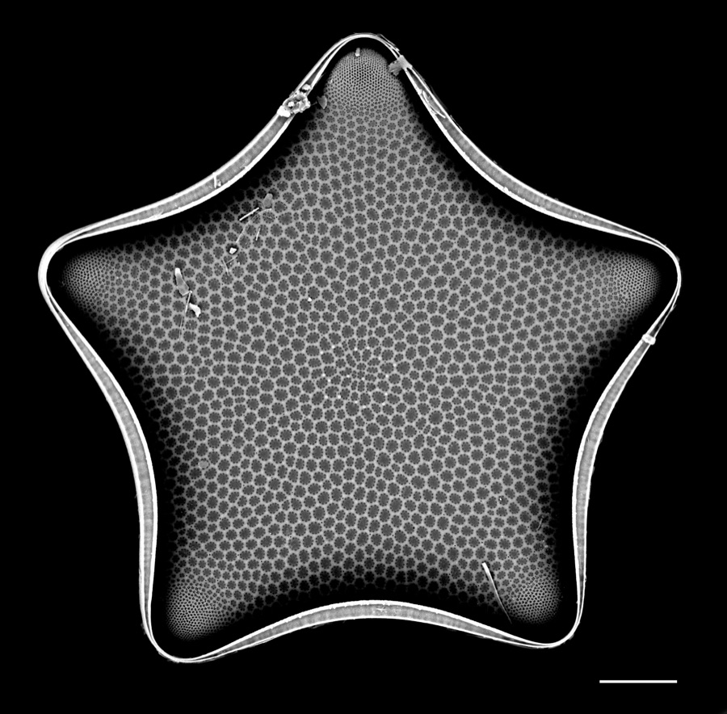

The [Plankton Manifesto](https://unglobalcompact.org/library/6242), issued through the UN Global Compact in 2024, calls for plankton-based solutions to the interconnected crises of biodiversity loss, climate change, and pollution. Rising to this challenge requires reliable regional baselines against which to measure ecological change.

My colleagues and I recently established the first consolidated baseline of diatom diversity in the Salish Sea: [a checklist](https://bdj.pensoft.net/article/189060/) of 924 taxa recorded between 1866 and 2026, published in the open-access *Biodiversity Data Journal* with Mark Webber, Elaine Humphrey, Arjan van Asselt, Alice Chang, and Evan Morien.

<em>Trigonium quinquelobatum</em>, one of the new regional reports among the 924 taxa. Credit: Mark Webber, Dr. Elaine Humphrey (CC-BY 4.0).

Nearly invisible to the naked eye, diatoms play an out-sized role at the foundation of marine food webs. In the Salish Sea, they have sustained the vast fisheries on which Coast Salish peoples have relied for millennia. Their sensitivity to environmental change also makes them valuable indicators of ecosystem health. Yet knowledge of their diversity has long remained scattered across historical literature, collections, and ecological studies. Consolidating this baseline record is especially important in the Salish Sea, a region home to some nine million people, where urbanization, industry, and shipping place growing pressure on marine ecosystems.

But assembling the checklist was just the beginning of the challenges laid out for us. Those challenges we address in [a recent paper](https://www.researchgate.net/publication/418048035_Linnaean_and_Darwinian_shortfalls_limit_long-term_monitoring_of_Salish_Sea_diatoms) in *Botany*, as part of its [UN Decade of Ocean Science for Sustainable Development collection](https://cdnsciencepub.com/topic/botany-unoceandecade): **can 160 years of diatom records serve as a reliable baseline for monitoring ecological change?**

Just as much as changing ecology, historical biodiversity records may reflect historically contingent changes in taxonomic understanding, methods, and available expertise. Much of what we know about diatom diversity comes from microscopy, though DNA sequencing is increasingly revealing lineages that have escaped morphological recognition.

Our research exposed two fundamental knowledge shortfalls that shape these records: the *Linnaean shortfall*, which limits our ability to recognize and consistently identify species, and the *Darwinian shortfall*, which leaves many recorded taxa without genetic references or well-resolved evolutionary relationships. Together, these gaps complicate comparisons across time, making it difficult to determine whether observed differences in diversity reflect ecological change, methodological biases, or shifts in taxonomic understanding.

Of the 924 taxa reported for the Salish Sea, 68% are documented through literature alone, 24% have modern morphological documentation, and 15% have been detected based on genetic barcodes. Only 5% are supported by all three sources, and fewer than half (47%) are represented by sequences in reference databases.

These shortfalls limit our ability to harness the potential of new monitoring technologies. DNA sequencing can now detect plankton diversity far beyond the reach of conventional microscopy, but our ability to interpret those discoveries has not kept pace. Reference libraries depend on reliably identified specimens and remain heavily weighted toward well-characterized taxa, leaving many detected organisms without names. **In the ocean, our capacity to detect biodiversity has outpaced our ability to identify it**—a challenge that persists even in the Salish Sea, with its 160 years of records, and is greater still in regions with less developed taxonomic knowledge.

Closing these gaps requires integrative taxonomy, bringing together microscopy, DNA sequencing, cloning, and well-documented specimens to establish reliable links between species names, morphology, and genetic identity. Yet equally essential are sustained partnerships between academic institutions and community scientists, whose observations, collections, and taxonomic expertise represent a significant but often overlooked scientific resource.

The recently described <em>Andrzeja fenestrata</em>, newly reported in the Salish Sea, offers one example of the overlooked diversity that community partnerships can bring to light. Credit: Mark Webber, Dr. Elaine Humphrey (CC-BY 4.0).

