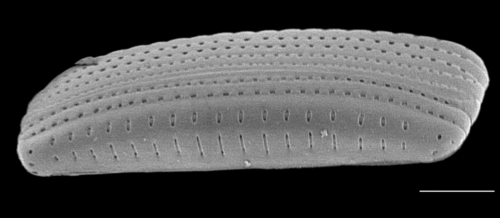

The [Plankton Manifesto](https://unglobalcompact.org/library/6242), issued through the UN Global Compact in 2024, calls for plankton-based solutions to the interconnected crises of biodiversity loss, climate change, and pollution. A noble effort! Yet rising to this challenge requires reliable regional baselines against which to measure ecological change.

In response, my colleagues and I recently established the first consolidated baseline of diatom diversity in the Salish Sea: [a checklist](https://bdj.pensoft.net/article/189060/) of 924 taxa recorded between 1866 and 2026, published in the open-access *Biodiversity Data Journal* with Mark Webber, Elaine Humphrey, Arjan van Asselt, Alice Chang, and Evan Morien.

<em>Trigonium quinquelobatum</em>, one of the new regional reports among the 924 taxa. Credit: Mark Webber, Dr. Elaine Humphrey (CC-BY 4.0).

Though nearly invisible to the naked eye, diatoms are photosynthetic algae that form the foundation of marine food webs, sustaining fisheries on which Coast Salish peoples have relied for millennia. Their sensitivity to environmental change also makes them valuable indicators of ecosystem health. Yet knowledge of their diversity in the Salish Sea has remained scattered across historical literature, collections, and surveys. Consolidating these records was especially vital in a region home to some nine million people and facing growing pressures from urbanization, industry, and shipping.

But assembling the checklist was just the beginning of the challenge, which we addressed in [a second paper](https://www.researchgate.net/publication/418048035_Linnaean_and_Darwinian_shortfalls_limit_long-term_monitoring_of_Salish_Sea_diatoms) in *Botany*, part of its **UN Decade of Ocean Science for Sustainable Development** collection: **can 160 years of diatom records serve as a reliable baseline for monitoring ecological change?**

Historical biodiversity records may reflect changes in taxonomic concepts, technologies, and expertise as well as ecological change. Much of what we know about diatom diversity comes from microscopy, though DNA sequencing is increasingly revealing lineages that have escaped morphological recognition.

Our research exposed two fundamental knowledge shortfalls that shape these records: the *Linnaean shortfall*, which limits our ability to recognize and consistently identify species, and the *Darwinian shortfall*, which leaves many recorded taxa without genetic references or well-resolved evolutionary relationships. Together, these gaps complicate comparisons across time, as apparent changes in diversity may reflect differences in taxonomic knowledge rather than ecological change.

Of the 924 taxa, 68% are documented through literature alone, 24% have modern morphological documentation, and 15% have genetic data. Only 5% are supported by all three, and fewer than half (47%) have sequences in reference databases.

These shortfalls limit our ability to realize the potential of new technologies. DNA sequencing can now detect plankton diversity far beyond the reach of conventional microscopy, but our ability to interpret those discoveries has not kept pace. Reference libraries depend on reliably identified specimens and remain heavily weighted toward well-characterized taxa, leaving many detected organisms without names. **Our capacity to detect biodiversity has thus outpaced our ability to identify it**—a challenge that persists even in the Salish Sea, with its 160 years of records, and is greater still in regions with less developed taxonomic knowledge.

Closing these gaps requires integrative taxonomy, bringing together microscopy, DNA sequencing, and well-documented specimens to establish reliable links between species names, morphology, and genetic identity. Equally essential are sustained partnerships between academic institutions and community scientists, whose observations, collections, and taxonomic expertise represent a substantial but often overlooked scientific resource.

The recently described <em>Andrzeja fenestrata</em>, newly discovered in the Salish Sea, offers one example of the overlooked diversity that such partnerships can bring to light. Credit: Mark Webber, Dr. Elaine Humphrey (CC-BY 4.0).

